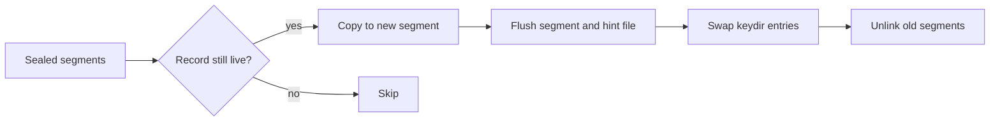
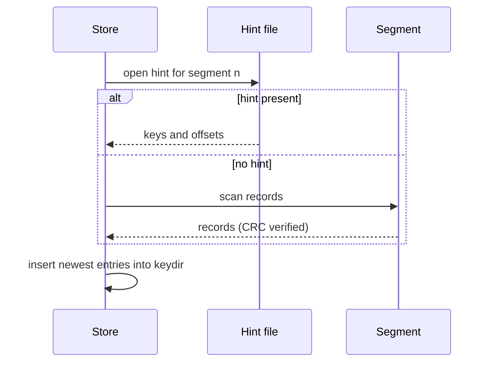

# Specimen: A Field Guide to Small Key-Value Stores

This document exists to exercise the reader styles. The prose is generic on purpose: it reads like a long reference note, with paragraphs of realistic length, nested lists, a wide table, several languages of code, a blockquote, and two diagrams. Open it with ⇧⌘V and toggle light, dark and paper to judge size, weight and width.

## 1. Why a log-structured design

A key-value store that appends every write to the end of a file trades disk space for simplicity. There is no in-place update, no page splitting, and no need to coordinate concurrent writers over the same region of the disk. The cost shows up later, when old versions of a key pile up and have to be reclaimed by compaction. For most read-heavy workloads that trade is worth making, because the write path becomes a single sequential append and the read path becomes one hash lookup followed by one positioned read. The interesting engineering lives in the parts around that core: how the in-memory index is rebuilt after a crash, how compaction avoids stalling foreground traffic, and how much of the file format is allowed to change between versions without breaking older readers.

It helps to be explicit about what the store does *not* promise. It does not offer range scans, because the index is a hash map rather than a sorted structure. It does not offer multi-key transactions. It does offer **durability per write** when the caller asks for it, at the price of an `fsync` on every append, and it offers a predictable latency profile because no request ever waits behind a large reorganisation of the data.

### 1.1 Terms used below

- **Segment**: an append-only file holding a run of records.
  - The *active* segment receives new writes.
  - *Sealed* segments are immutable and eligible for compaction.
    - A sealed segment is never reopened for writing.
    - Its hint file, if present, speeds up index rebuilds.
- **Keydir**: the in-memory map from key to the newest record's location.
- **Tombstone**: a record that marks a key as deleted.

1. Append the record to the active segment.
2. Update the keydir entry for the key.
   1. If the key already existed, the old record becomes garbage.
   2. If the record is a tombstone, remove the entry instead.
3. Return to the caller, optionally after `fsync`.

- [x] Write path documented
- [ ] Compaction scheduling documented
- [ ] Recovery tested against torn writes

#### 1.1.1 A note on naming

Names in this guide follow the original paper where one exists, and plain English everywhere else. When two names exist for the same thing, the shorter one wins.

## 2. Record format

Every record starts with a fixed header followed by the key and value bytes. The header carries a checksum over everything after it, so a reader can detect a torn write at the end of a segment and stop there instead of returning garbage. The timestamp is advisory; ordering is determined by position in the file, never by the clock.

| Field | Offset | Size (bytes) | Type | Required | Checked by CRC | Default | Notes |
|---|---|---|---|---|---|---|---|
| crc | 0 | 4 | u32 | yes | no | — | CRC-32C of all following bytes in the record |
| timestamp | 4 | 8 | u64 | yes | yes | 0 | Milliseconds since epoch, advisory only |
| key_size | 12 | 4 | u32 | yes | yes | — | Maximum 64 KiB in practice |
| value_size | 16 | 4 | u32 | yes | yes | — | `0xFFFFFFFF` marks a tombstone |
| flags | 20 | 1 | u8 | no | yes | 0 | Bit 0: compressed; bits 1–7 reserved |
| key | 21 | key_size | bytes | yes | yes | — | Opaque; compared byte-wise |
| value | 21 + key_size | value_size | bytes | no | yes | — | Absent for tombstones |

A smaller table should still span the column:

| Operation | Cost |
|---|---|
| get | one hash lookup, one read |
| put | one append, one hash update |
| delete | one append (tombstone) |

## 3. Implementation sketches

The index entry in TypeScript, with a deliberately long line to check that code scrolls sideways instead of wrapping:

```ts
export interface KeydirEntry {
  segmentId: number;
  offset: number;
  size: number;
  timestamp: number;
}

export function isNewer(a: KeydirEntry, b: KeydirEntry): boolean {
  return a.segmentId > b.segmentId || (a.segmentId === b.segmentId && a.offset > b.offset); // position decides, never the clock
}

const keydir = new Map<string, KeydirEntry>();
```

The same idea in Java, as a record with a compact constructor:

```java
public record KeydirEntry(int segmentId, long offset, int size, long timestamp) {
    public KeydirEntry {
        if (offset < 0 || size < 0) {
            throw new IllegalArgumentException("offset and size must be non-negative");
        }
    }

    public boolean isNewerThan(KeydirEntry other) {
        return segmentId > other.segmentId()
            || (segmentId == other.segmentId() && offset > other.offset());
    }
}
```

A configuration file:

```json
{
  "dataDir": "/var/lib/kv",
  "segmentMaxBytes": 268435456,
  "fsync": "per-write",
  "compaction": { "minGarbageRatio": 0.4, "maxConcurrent": 1, "window": "02:00-05:00" },
  "hintFiles": true
}
```

And the operational side in bash:

```bash
#!/usr/bin/env bash
set -euo pipefail

DATA_DIR="${1:-/var/lib/kv}"
for seg in "$DATA_DIR"/*.seg; do
  size=$(stat -f %z "$seg")
  printf '%-40s %12d bytes\n' "$(basename "$seg")" "$size"
done | sort -k2 -n
```

Inline code appears in running text too: call `compact(segmentIds)` only on sealed segments, and never pass the id returned by `activeSegment()`.

## 4. Compaction

> Compaction is garbage collection for data you have already promised to keep. The hard part is not deciding what to delete; it is deleting it without anyone noticing.
>
> A good compactor is boring: it runs in a fixed window, it never holds a lock that a reader needs, and it leaves the old segments in place until the new ones are durable.

The compactor reads sealed segments oldest first, copies every record whose keydir entry still points at it, and writes the survivors to a fresh segment. Only after the new segment and its hint file are flushed does it swap the keydir entries and unlink the old files. A crash at any point leaves either the old segments or the new ones fully valid, never a mixture, because the swap is the last step and is itself idempotent.



## 5. Recovery

On start-up the store rebuilds the keydir by scanning segments in order. Hint files make this fast, since they hold only keys and locations; segments without a hint file are scanned record by record, verifying each checksum.



---

### 5.1 What to check after a crash

1. The last record of the active segment may be torn; truncate at the first checksum failure.
2. Hint files older than their segment are ignored and rebuilt.
3. The keydir must never point at a byte range beyond the end of a file.

[Back to the top](#specimen-a-field-guide-to-small-key-value-stores)
